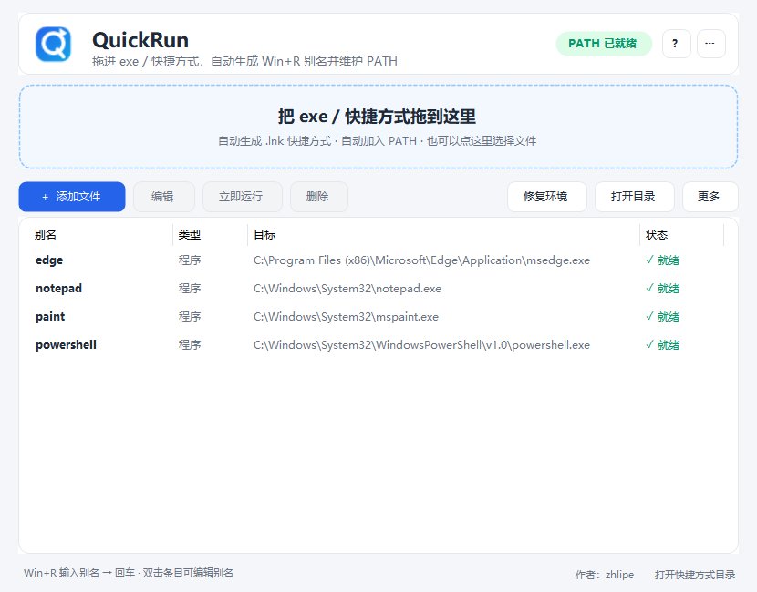

# QuickRun · Win+R 快捷启动

把 **exe / 快捷方式 / 文件夹** 拖进窗口，自动在快捷方式目录（默认 **`D:\Quick`**）生成一个 `.lnk` 快捷方式，
并自动把这个目录加入 **当前用户 PATH**。以后可以在「更多 → 更改快捷方式目录…」里随时更换存放目录。

之后按 `Win + R`，输入别名回车，就能启动对应程序。快捷方式由 Shell 直接启动目标，
**不会再闪黑窗口**。不需要管理员权限，不改系统级环境变量，也不联网。



> 上图为界面预览（PATH 已就绪状态）。

## 快速开始（3 步）

1. **双击 `QuickRun.exe`**。
   程序会自动确保当前快捷方式目录（默认 `D:\Quick`）在用户 PATH 中，
   右上角显示 **PATH 已就绪** 就表示配置成功。

   > 请先把程序放到普通目录（例如 `D:\Tools\QuickRun` 或桌面），在 **Windows 资源管理器**里双击运行。
   > 如果从沙箱、只读目录、压缩包预览或对话界面直接打开，程序会被限制写入 `D:\Quick` 和注册表，
   > 顶部会提示 PATH 未配置，这是运行环境限制，不是程序本身的问题。

2. **拖入文件**。
   把 `exe`、`.lnk` 快捷方式或文件夹拖到窗口任意位置；也可以点拖放区、`+ 添加文件` 按钮。

3. **Win + R 启动**。
   输入自动生成的别名（不要输入 `.lnk`），回车。

示例：把 `D:\Tools\Notepad3\Notepad3.exe` 拖进来 →

```text
别名：Notepad3
快捷方式：D:\Quick\Notepad3.lnk
启动：Win + R → Notepad3 → 回车
```

## 目录结构

```text
D:\Quick\                       默认快捷方式目录；这个目录会在用户 PATH 中
├─ Notepad3.lnk                 QuickRun 生成的别名
├─ 微信.lnk                     你自己手动放的快捷方式（QuickRun 不会动）
└─ ...

%USERPROFILE%\QuickRun\         数据目录（不在 PATH 中）
└─ data\
   ├─ config.json               别名配置（可手动备份/编辑）
   ├─ settings.json             快捷方式目录设置（改过目录后才会有）
   └─ quickrun.log              运行日志（排查问题时看）
```

- 默认快捷方式目录是 `D:\Quick`；可以在程序里改成其它目录，见下文。
- 数据目录可以用 `QUICKRUN_HOME` 覆盖，主要用于测试或绿色版部署。
- 环境变量 `QUICKRUN_ALIAS_DIR` 可以强制指定快捷方式目录；设置后界面里的「更改快捷方式目录」会被禁用。
- 如果当前快捷方式目录不可写，程序会自动回退到 `%USERPROFILE%\QuickRun\aliases`。

## 更改快捷方式存放目录

1. 点右上角 **`⋯ 更多`** → **「更改快捷方式目录…」**。
2. 选择一个新的文件夹（不能选 QuickRun 的数据目录或其上下级目录）。
3. 程序会把现有别名迁移到新目录，并把新目录加入当前用户 PATH；
   旧目录里不属于 QuickRun 的文件不会被删除。
4. 设置会保存到 `%USERPROFILE%\QuickRun\data\settings.json`，下次启动继续生效。
5. 如果旧目录迁移后已经空了，程序会询问是否把旧目录从 PATH 中移除。

## PATH 是怎么自动维护的

- 默认确保当前快捷方式目录（初始为 **`D:\Quick`**）在用户 PATH 中；只修改注册表 **`HKCU\Environment`** 的 `Path`，不碰系统 PATH。
- 写入前会先检查：已经包含就绝不重复添加；添加时保留其它所有 PATH 项。
- 写入成功后广播 `WM_SETTINGCHANGE`，让资源管理器等程序重新读取环境变量。
- 启动时自动检查；如果 PATH 被安全软件/组策略拦截，窗口顶部会出现橙色提示，
  可以点 **重试**，或按提示把 `D:\Quick` 手动加入用户 PATH。
- 正常桌面环境修改 HKCU 不需要管理员；若公司电脑有注册表防护，以提示和手动方案为准。

> `D:\Quick` 可能本来就是你手动维护的快捷方式目录，里面还有你自己的文件。
> QuickRun 只会新增/删除它自己管理的那几条 `.lnk`，不会清理其它文件。

## 别名命名规则

- 自动从文件名生成：去掉扩展名，空格和标点转成 `-`，例如
  `My Tool 2.0.exe` → `My-Tool-2-0`。
- 只允许：字母、数字、`-`、`_`；最长 40 个字符；必须以字母或数字开头。
- 自动避开 Windows 保留名（`CON`、`PRN`、`AUX`、`NUL`、`COM1`…）。
- 自动避开已有别名、`D:\Quick` 中已存在的同名 `.lnk`，以及 PATH 中的同名命令：
  - 如果 PATH 里的同名命令指向**同一个目标**，仍然使用原名；
  - 如果指向别处，自动加 `-run` 后缀，例如 `code` → `code-run`；
  - 仍然冲突时继续加 `-2`、`-3`。
- 重复拖入同一个目标会被跳过，不会生成第二条记录。
- 如果 `D:\Quick` 里已有同名的手动快捷方式（例如 `微信.lnk`），会生成 `微信-2.lnk`，不会覆盖你的文件。
- 生成后可以双击列表里的别名，或右键 → **编辑**，随时改名/改目标。

## 界面说明

| 位置 | 功能 |
| --- | --- |
| 拖放区 | 拖入文件；点一下也可以选择文件 |
| `+ 添加文件` | 打开文件选择框，可多选 |
| `立即运行` | 启动当前选中的别名；列表里按 `Enter` 也可以 |
| `编辑` | 修改别名、目标路径、备注；双击别名或按 `F2` 也可以 |
| `删除` | 删除快捷方式和配置记录；列表里按 `Delete` 也可以 |
| `打开目录` | 打开当前快捷方式目录 |
| `修复环境` | 重新生成全部快捷方式并重新检查 PATH |
| `更多`（右上角 `⋯` 或底部按钮） | 更改快捷方式目录、环境自检、重新生成快捷方式、从用户 PATH 移除、打开数据/快捷方式目录、使用说明、关于 |
| 顶部状态胶囊 | `PATH 已就绪` / `PATH 未配置` |

> 右键别名列表还有：立即运行、编辑别名、复制别名、在资源管理器中显示目标、删除别名。

### 环境自检

`更多 → 环境自检` 会列出：数据目录/快捷方式目录是否可写、配置文件、设置文件、日志、用户 PATH 是否包含
快捷方式目录、每条别名的目标是否存在、`.lnk` 是否生成等。发现问题可以直接点 **修复环境**。

## 常见问题

**1. Win+R 输入别名没反应？**

- 看右上角是否显示 `PATH 已就绪`；不是的话点 `修复环境` 或按提示重试。
- 确认当前快捷方式目录（默认 `D:\Quick`）里的 `<别名>.lnk` 存在。
- 重新打开一个 `Win+R` 或注销/重新登录后再试。
- 打开 `更多 → 环境自检`，看 PATH 和快捷方式状态。

**2. 启动时还会闪黑窗口吗？**

不会。现在每个别名都是 `.lnk` 快捷方式，Windows Shell 直接启动目标，不经过 `cmd.exe`，
所以没有命令行黑框。拖入 `.bat` / `.cmd` 程序本身时，那个程序自己仍可能打开控制台。

**3. 为什么别名后面多了 `-run` 或 `-2`？**

因为它和 PATH 中已有的命令重名，或和已有别名/当前快捷方式目录里的快捷方式重名。
工具会自动避让，避免 Win+R 启动到别的程序。

**4. 拖进去没生成快捷方式？**

- 同一个目标重复拖入会被跳过（底部状态栏会提示）。
- 目标文件不存在、没有权限读取时，会提示原因。
- `.lnk` 快捷方式会被原样复制；如果快捷方式本身损坏，会按目标丢失处理。
- 如果当前快捷方式目录不可写，程序会提示并尝试回退目录。

**5. 目标程序移动/删除了？**

别名列表状态会变成 `目标丢失`。双击编辑，重新选择新路径即可；
也可以先删除再拖入新文件。

**6. 中文别名可以吗？**

可以，但不建议。Win+R 输入中文需要切换输入法，且部分启动器对中文命令兼容性一般；
优先用英文 + 数字。

**7. 会不会影响系统里已有的 PATH？**

只确保当前快捷方式目录这一项存在，其它项原样保留。
注意：当前快捷方式目录可能是你手动维护的目录；`更多 → 从用户 PATH 移除` 会把整个目录移出 PATH，
如果你还有手动快捷方式依赖它，请不要这样操作。

**8. 需要管理员权限吗？**

不需要。只写当前用户注册表 `HKCU`、数据目录和当前快捷方式目录。
如果公司电脑有注册表保护，按橙色提示手动加 PATH 即可。

**9. 提示“运行环境受限”，PATH 被拒绝？**

先看程序的数据目录：如果日志里显示 `QuickRun=...\QuickRunData`（程序目录下的回退目录），
说明程序是在**受限环境**中启动的（例如从对话界面/沙箱打开、放在只读目录、从压缩包预览直接运行）。
这个环境禁止写用户目录、当前快捷方式目录和 `HKCU\Environment`，所以 PATH 配置一定失败。

处理办法：

1. 关闭 QuickRun 窗口。
2. 把整个 `QuickRun-1.0.0` 文件夹复制到普通可写目录，例如 `D:\Tools\QuickRun`。
3. 在 Windows 资源管理器里进入该目录，**双击 `QuickRun.exe`**（不要从对话窗口/压缩包预览里点）。
4. 正常启动后应显示 `PATH 已就绪`，日志中的 `QuickRun=` 会是 `%USERPROFILE%\QuickRun`。

如果这样操作后仍然报“拒绝访问”，那就是这台电脑的安全软件/组策略在保护注册表，
可点「复制目录」后手动把当前快捷方式目录（默认 `D:\Quick`）加入“用户环境变量 → Path”。

**10. 从旧版本（`.bat` 别名）升级会怎样？**

新版本会把配置里已有的别名重新生成到当前快捷方式目录下的 `.lnk`，并在生成成功后删除旧目录中同名的
`.bat`/`.cmd`。旧的 `%USERPROFILE%\QuickRun\aliases` PATH 项如果还保留，不影响使用，
可以手动从环境变量里删掉；旧目录中不属于 QuickRun 的文件不会被删除。

## 卸载

1. 关闭 QuickRun。
2. 在程序里删除全部别名（或直接删除当前快捷方式目录里由 QuickRun 生成的 `.lnk`）。
3. 删除 `QuickRun.exe` 和数据目录 `%USERPROFILE%\QuickRun`。
4. **不要直接删除整个快捷方式目录**：里面可能还有你手动放的快捷方式。
   如果该目录只给 QuickRun 用，再从用户 PATH 中移除这一项。

不会残留系统级文件或服务。

## 命令行 / 构建（开发者）

隐藏命令行参数（主要给脚本/测试/卸载用）：

```text
QuickRun.exe --repair           重建全部快捷方式并重新检查/写入 PATH
QuickRun.exe --remove-path      从用户 PATH 移除当前快捷方式目录
QuickRun.exe --selftest <报告>  运行内置自检并输出报告
QuickRun.exe --shot <png>       生成界面预览截图
```

从源码构建（Windows 自带 .NET Framework 4.x，不需要安装 SDK）：

```powershell
powershell.exe -NoProfile -ExecutionPolicy Bypass -File .\build.ps1
```

输出同目录 `QuickRun.exe`。构建脚本使用 `Microsoft.CSharp.CSharpCodeProvider`
（CodeDom）在进程内编译，不依赖 `dotnet` / Visual Studio。

发布包内容：

```text
QuickRun.exe          主程序
README.md             快速入口
使用说明.md           本文件
screenshots\main.png  界面截图
QuickRun.cs           源码
build.ps1             构建脚本
assets\quickrun.ico   图标
assets\app.manifest   清单（asInvoker，无需管理员）
```

## 已验证

- 内置自检：29 项通过 / 0 失败（别名规则、`.lnk` 创建/解析/复制、JSON 配置、设置保存/读取、PATH 合并等）。
- UI 冒烟测试：模拟拖放新增、快捷方式生成并指向正确目标、编辑不改名保存、重名拦截，全部通过。
- 真实环境验证：默认快捷方式目录为 `D:\Quick`，生成的 `.lnk` 能解析到目标；
  `D:\Quick` 已在用户 PATH 中，PATH 检查通过。
- 目录设置验证：保存 `settings.json` 后重新初始化，程序会恢复自定义快捷方式目录并正常生成 `.lnk`。

## 作者

- 作者：zhlipe
